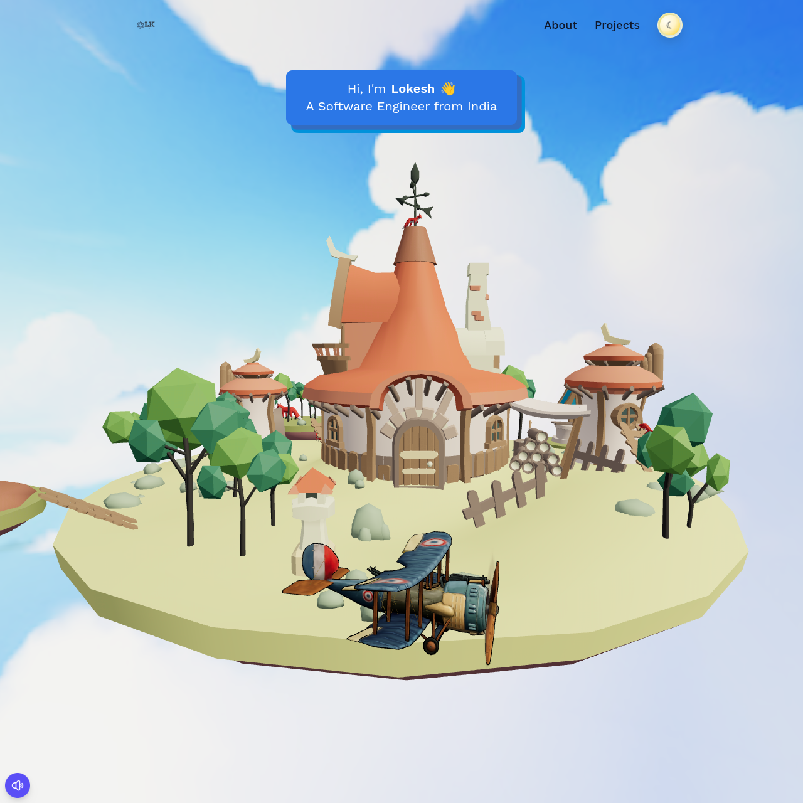

# 🚀 3D Developer Portfolio

\<p align="center"> \<strong>An interactive 3D portfolio built to showcase my skills, projects, and journey as a developer.\</strong> \</p>

\<p align="center"> \<a href="[https://3-d-portfolio-ten-mu-39.vercel.app/](https://3-d-portfolio-ten-mu-39.vercel.app/)"> \ \</a> \<a href="[https://github.com/lokeshkumar72/3D_Portfolio](https://github.com/lokeshkumar72/3D_Portfolio)"> \ \</a> \</p>

---

## 📸 Project Preview

\<p align="center"> \ \</p>

\<p align="center"> \<i>Homepage preview of my interactive 3D developer portfolio.\</i> \</p>

---

## 👨‍💻 About the Project

This is my personal 3D developer portfolio, created to present my development skills and projects through an interactive web experience.

Instead of using a traditional portfolio layout, I used 3D graphics, animations, and modern frontend technologies to create a more engaging experience.

The portfolio focuses on showcasing my work, technical knowledge, and development journey in a visually interesting way.

## ✨ Features

- 🌐 Interactive 3D website experience
- 🎨 Modern and clean user interface
- 📱 Responsive design
- ⚡ Smooth animations and transitions
- 🧩 Reusable React components
- 🎮 3D models and rendering with Three.js
- 📬 Email integration using EmailJS
- 🚀 Deployed using Vercel

## 🛠️ Tech Stack

| Technology        | Purpose                    |
| ----------------- | -------------------------- |
| React.js          | Frontend development       |
| JavaScript        | Application logic          |
| Three.js          | 3D graphics                |
| React Three Fiber | 3D rendering in React      |
| React Three Drei  | 3D utilities and helpers   |
| Tailwind CSS      | Styling                    |
| Vite              | Development and build tool |
| EmailJS           | Email integration          |
| Git & GitHub      | Version control            |
| Vercel            | Deployment                 |

## ⚙️ Getting Started

Follow these steps to run the project locally.

### Prerequisites

- Node.js
- npm
- Git

### 1. Clone the repository

```bash
git clone https://github.com/lokeshkumar72/3D_Portfolio.git
```

### 2. Navigate to the project

```bash
cd 3D_Portfolio
```

### 3. Install dependencies

```bash
npm install
```

### 4. Start the development server

```bash
npm run dev
```

### 5. Open in browser

```text
http://localhost:5173
```

## 📁 Project Structure

```text
3D_Portfolio/
│
├── public/
│   └── Static assets and public resources
│
├── src/
│   ├── assets/
│   ├── components/
│   ├── constants/
│   ├── App.jsx
│   ├── main.jsx
│   └── styles/
│
├── screenshots/
│   └── homepage.png
│
├── index.html
├── package.json
├── vite.config.js
├── tailwind.config.js
└── README.md
```

## 🌍 Live Demo

**Check out the deployed project:**

🔗 [https://3-d-portfolio-ten-mu-39.vercel.app/](https://3-d-portfolio-ten-mu-39.vercel.app/)

## 👨‍🎓 About Me

**Lokesh Kumar Singh**

Full Stack Developer | React.js | JavaScript | MERN Stack

I enjoy building modern web applications, exploring new technologies, and creating interactive user experiences.

- GitHub: [@lokeshkumar72](https://github.com/lokeshkumar72)
- LinkedIn: [Lokesh Kumar Singh](https://www.linkedin.com/in/lokesh-kumar-singh-/)

## 🤝 Feedback & Contributions

Suggestions and feedback are always welcome.

If you find something interesting in this project, feel free to explore the source code and share your thoughts.

## ⭐ Support

If you like this project, consider giving the repository a star. It motivates me to keep learning and building better projects.

---

\<p align="center">
&#x20; \<strong>Designed & Developed by Lokesh Kumar Singh\</strong>
&#x20; \<br/>
&#x20; \<i>Building experiences, one project at a time. 🚀\</i>
\</p>
